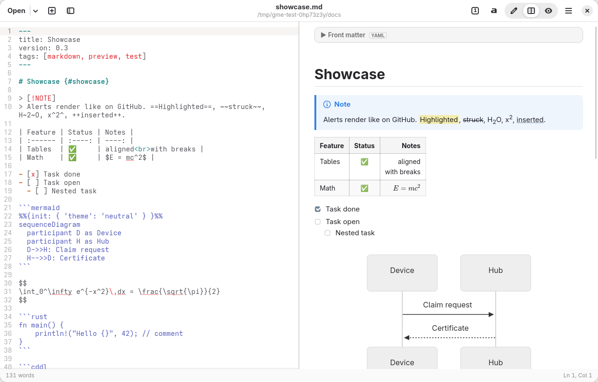

# Markdown Editor for GNOME

A Markdown editor and viewer for GNOME, modelled on GNOME Text Editor. It is built with
GTK 4, libadwaita, GtkSourceView 5 and libspelling, and renders a live preview in WebKitGTK.



## Features

**Editor**
- Tabs with a tab overview. Dragging a tab out opens it in a new window.
- Open, recent documents, Save / Save As / Save All, and Reload. Opening a file from the file manager
  adds it as a tab in the running window.
- Prompts before closing a document or window with unsaved changes. When another program changes a
  file on disk, the editor reloads it if it has no unsaved changes; otherwise it shows a banner.
  Saving over a newer file on disk asks first.
- Markdown syntax highlighting with the GtkSourceView style schemes. The light and dark variants
  follow the system style.
- Line numbers, current-line highlight, right margin, wrapping, overview map and bracket matching.
- Spell checking. Code and URLs are not checked.
- Find and replace: case-sensitive, whole-word and regex matching, with a match count.
- Go to line, a heading outline sidebar (F9) with a filter, and a status bar with line, column,
  word count and selection length.
- Formatting commands in a header menu and on shortcuts:
  - Inline: bold, italic, strikethrough, highlight, inline code, inline math, link and image. Pasting
    a URL over selected text makes a link.
  - Structure: headings, lists, task lists, quotes and code blocks.
  - Inserts: tables, Mermaid diagrams, math blocks, `<details>` sections, alerts, footnotes, front
    matter, a table of contents and image carousels.
  - **Format Table** realigns a GFM table, including wide characters.
- Smart lists: Enter continues the current list, task list or quote (numbers increment). Enter on
  an empty item ends the list. Tab and Shift+Tab nest and un-nest an item.
- Zoom applies to the editor and the preview together. The app has a fullscreen mode.
- The open documents are restored on start. Every setting is in Preferences (Ctrl+,).

**Preview**
- Three view modes: editor only, side by side, and preview only (Ctrl+Alt+1/2/3). The preview can
  sit on either side of the editor.
- The preview and the editor scroll together, in both directions. Double-click a block in the
  preview to put the cursor on its source line.
- Clicking a task checkbox in the preview toggles it in the source.
- Links:
  - `#anchors` scroll the preview.
  - Relative and `file://` links to Markdown files open in a tab and jump to their `#anchor`.
  - Hugo-style links resolve against the repository: `/services/Foo/`, `../foo`, `_index.md` and
    `index.md`.
  - Other files open in the default application, and web links open in the browser.
- Clicking an image or a diagram opens it in a lightbox; Ctrl+scroll zooms it.
- Print, or print to PDF (Ctrl+P), and export to a self-contained HTML file.

### Rendering support

| Syntax | Notes |
| --- | --- |
| CommonMark + GFM | Tables (column alignment, `<br>` in cells), task lists, strikethrough, autolinks |
| GitHub / Antigravity alerts | `> [!NOTE]` `[!TIP]` `[!IMPORTANT]` `[!WARNING]` `[!CAUTION]` and custom types |
| Mermaid | Every diagram type, including `%%{init}%%` directives. Rendered offline, cached per diagram, and errors are shown inline. In dark mode, the light `neutral`, `default` and `forest` themes switch to `dark`. |
| Math (KaTeX) | `$inline$` and `$$display$$` (pandoc rules, so `$5 and $10` stays text), plus `math` fences |
| Syntax highlighting | All highlight.js languages, plus CDDL, Rego, ASN.1 and CBOR diagnostic notation |
| Front matter | YAML `---` (shown as a table) and TOML `+++` (shown raw), collapsed by default |
| Antigravity carousels | `` ````carousel `` fences with `<!-- slide -->` separators |
| Footnotes, definition lists, abbreviations | `[^1]`, `Term` / `: definition`, `*[HTML]: …` |
| `==mark==`, `++ins++`, `~sub~`, `^sup^` | |
| goldmark block attributes | `# Heading {#id .class}` |
| Hugo shortcodes | `` / `{}` appear as labelled badges, since only the site build can run them |
| Raw HTML | `<details>`, `<summary>`, `<kbd>`, `<sub>`, `<span>` and others. `<iframe>`, `<video>` and `<audio>` become links. |

Heading anchors follow GitHub's and Hugo's `github` style, so links such as
`#43-record-envelope` resolve as they do on GitHub and on Hugo sites.

### Security model

The preview runs no script that comes from documents. Rendered HTML is sanitised with DOMPurify, and
a Content-Security-Policy allows scripts only from the application's own files. The CSP also blocks
`connect-src`, frames and plugins. Mermaid runs at `securityLevel: "strict"`. The page itself cannot
navigate: every link goes to the application.

Remote images in a document still load, as in any Markdown viewer.

## Requirements

On Fedora, these packages are installed by default on Workstation:

```
python3-gobject gtk4 libadwaita gtksourceview5 webkitgtk6.0 libspelling
```

Running the editor needs no Node.js. The preview assets ship pre-built in
`gnome_markdown_editor/web/vendor/`.

## Run, install, test

```sh
make run                 # run from the checkout
make install             # install to ~/.local (PREFIX=/usr/local for system-wide)
make uninstall

make test-unit           # GTK-free helpers
make test-gui            # drives the real app in the running session (isolated config)
make test-corpus DIRS="$HOME/docs"   # renders every .md through the preview bundle
make vendor              # rebuild preview assets from web-src/ (needs Node.js + network)
```

Debugging: `GME_DEBUG=1` prints preview console messages and enables the WebKit inspector
(right-click → Inspect Element).

## Layout

```
bin/gnome-markdown-editor        launcher
gnome_markdown_editor/
  application.py                 Adw.Application, global actions, editor font, shortcuts/about dialogs
  window.py                      window, tabs, header bar, outline, actions, link routing, export
  document.py                    one document: GtkSourceView, file I/O, change monitor, scroll sync
  editor.py                      Markdown editing commands and smart typing
  search.py                      find and replace bar
  preview.py                     WebKit preview and host↔page bridge
  preferences.py                 preferences dialog
  settings.py                    JSON-backed settings (GObject properties)
  markdown_utils.py              headings/slugs, lists, tables (pure Python, unit-tested)
  web/preview.css                preview stylesheet (libadwaita palette, light/dark)
  web/vendor/                    built renderer bundle, Mermaid, KaTeX, highlight.js themes
web-src/                         renderer source (markdown-it + plugins) and build script
tests/                           unit tests, GUI smoke test, fixtures
data/                            desktop entry, AppStream metainfo
```

Settings live in `~/.config/gnome-markdown-editor/settings.json`.
