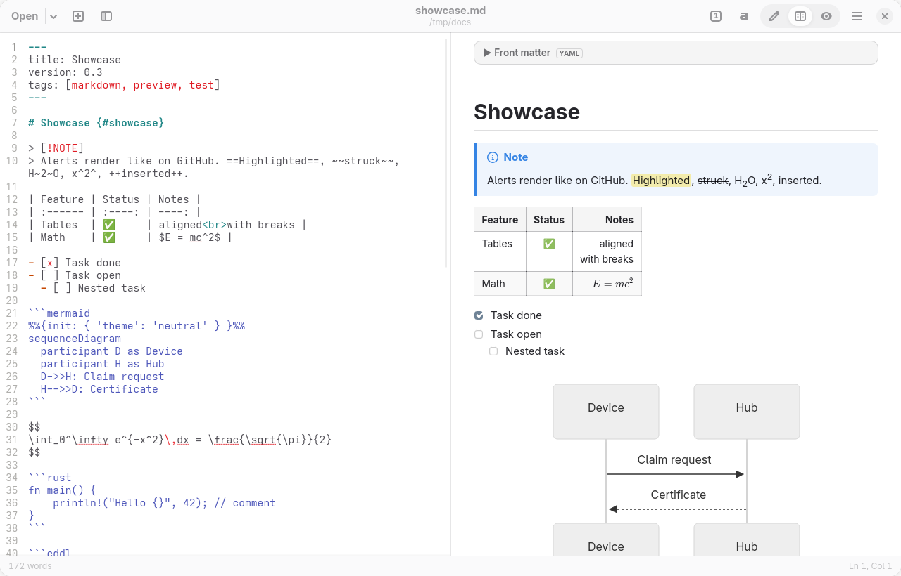

# Markdown Editor

A Markdown editor and viewer for GNOME, modelled on GNOME Text Editor. The preview sits next to
the text, scrolls with it, and renders what technical documents use:

- **Mermaid diagrams** of every type, **KaTeX math**, and syntax highlighting for all common
  languages (plus CDDL, Rego, ASN.1 and CBOR).
- **Marp slide decks**: a document with `marp: true` in its front matter previews as slides, with
  Marp's themes and directives, and the editor highlights directives and slide separators.
- **GitHub and Hugo conventions**: alerts, task lists, footnotes, front matter, heading anchors as
  GitHub and Hugo generate them, and links between documents of a repository.
- **Large documents stay responsive**: a multi-megabyte specification re-renders only the section
  being edited, and diagrams draw as they scroll into view.
- **Changelogs fold away** until they are needed.

It is built with GTK 4, libadwaita, GtkSourceView 5 and libspelling, and renders the preview in
WebKitGTK.



## Features

**Editor**
- Tabs with a tab overview. Dragging a tab out opens it in a new window.
- Open, recent documents, Save / Save As / Save All, and Reload. Opening a file from the file manager
  adds it as a tab in the running window.
- Prompts before closing a document or window with unsaved changes. When another program changes a
  file on disk, the editor reloads it if it has no unsaved changes; otherwise it shows a banner.
  Saving over a newer file on disk asks first.
- Markdown syntax highlighting with the GtkSourceView style schemes. The light and dark variants
  follow the system style.
- Line numbers, current-line highlight, right margin, wrapping, overview map and bracket matching.
- Spell checking. Code and URLs are not checked.
- Find and replace: case-sensitive, whole-word and regex matching, with a match count.
- Go to line, a heading outline sidebar (F9) with a filter, and a status bar with line, column,
  word count and selection length.
- Formatting commands in a header menu and on shortcuts:
  - Inline: bold, italic, strikethrough, highlight, inline code, inline math, link and image. Pasting
    a URL over selected text makes a link.
  - Structure: headings, lists, task lists, quotes and code blocks.
  - Inserts: tables, Mermaid diagrams, math blocks, `<details>` sections, alerts, footnotes, front
    matter, a table of contents and image carousels.
  - **Format Table** realigns a GFM table, including wide characters.
- Smart lists: Enter continues the current list, task list or quote (numbers increment). Enter on
  an empty item ends the list. Tab and Shift+Tab nest and un-nest an item.
- Zoom applies to the editor and the preview together. The app has a fullscreen mode.
- The open documents are restored on start. Every setting is in Preferences (Ctrl+,).

**Preview**
- Three view modes: editor only, side by side, and preview only (Ctrl+Alt+1/2/3). The preview can
  sit on either side of the editor.
- The preview and the editor scroll together, in both directions. Double-click a block in the
  preview to put the cursor on its source line.
- Clicking a task checkbox in the preview toggles it in the source.
- Links:
  - `#anchors` scroll the preview.
  - Relative and `file://` links to Markdown files open in a tab and jump to their `#anchor`.
  - Hugo-style links resolve against the repository: `/services/Foo/`, `../foo`, `_index.md` and
    `index.md`.
  - Other files open in the default application, and web links open in the browser.
- Clicking an image or a diagram opens it in a lightbox; Ctrl+scroll zooms it.
- Print, or print to PDF (Ctrl+P), and export to a self-contained HTML file.

### Rendering support

| Syntax | Notes |
| --- | --- |
| CommonMark + GFM | Tables (column alignment, `<br>` in cells), task lists, strikethrough, autolinks |
| GitHub / Antigravity alerts | `> [!NOTE]` `[!TIP]` `[!IMPORTANT]` `[!WARNING]` `[!CAUTION]` and custom types |
| Mermaid | Every diagram type, including `%%{init}%%` directives. Rendered offline, cached per diagram, and errors are shown inline. In dark mode, the light `neutral`, `default` and `forest` themes switch to `dark`. |
| Math (KaTeX) | `$inline$` and `$$display$$` (pandoc rules, so `$5 and $10` stays text), plus `math` fences |
| Syntax highlighting | All highlight.js languages, plus CDDL, Rego, ASN.1 and CBOR diagnostic notation |
| Front matter | YAML `---` (shown as a table) and TOML `+++` (shown raw), collapsed by default |
| Changelogs | Sections titled *Changelog*, *Revision History*, *Release Notes* and similar, or titled with "changes"/"history" and listing versions or dates, fold into a collapsed block that shows the entry count. Only the lists and tables right after the heading fold; prose after them stays visible. Links to the section open it, printing expands it, and Preferences → Preview turns folding off. |
| Marp slide decks | Front matter `marp: true` renders the document with [Marp Core](https://github.com/marp-team/marp-core): slides split at `---`, the `default`, `gaia` and `uncover` themes, global and local directives (`<!-- _class: lead -->`), `<style>` and `style:` CSS, background images (``), image filters and math (KaTeX, also for `math: mathjax`). Custom themes are found by name: a stylesheet declaring `/* @theme name */` next to the document, in its `assets`, `themes`, `theme`, `css` or `.marp` folder, or in those places of the folders above it up to the repository root. Slides scale to the preview width, scroll in sync with the source and print one per page. Not supported: Marp's runtime script, so `<!-- fit -->` headings and long code blocks are not shrunk to fit, and no presenter view. The editor highlights directives, directive comments, slide separators and image keywords. |
| Antigravity carousels | `` ````carousel `` fences with `<!-- slide -->` separators |
| Footnotes, definition lists, abbreviations | `[^1]`, `Term` / `: definition`, `*[HTML]: …` |
| `==mark==`, `++ins++`, `~sub~`, `^sup^` | |
| goldmark block attributes | `# Heading {#id .class}` |
| Hugo shortcodes | `` / `{}` appear as labelled badges, since only the site build can run them |
| Raw HTML | `<details>`, `<summary>`, `<kbd>`, `<sub>`, `<span>` and others. `<iframe>`, `<video>` and `<audio>` become links. |

Heading anchors follow GitHub's and Hugo's `github` style, so links such as
`#43-record-envelope` resolve as they do on GitHub and on Hugo sites.

### Large documents

The preview stays responsive on multi-megabyte documents. A 2 MB, 9,400-line specification with
40 diagrams is the reference case:

- The document renders in sections split at top-level headings. An edit re-renders only the
  section it touches; the others keep their DOM, including drawn diagrams and open sections.
- For large files, the editor sends the page only the changed text, not the whole document.
- Mermaid diagrams render as they come near the viewport, one at a time, so scrolling keeps working.
  Printing and export render all of them first.
- Off-screen sections skip layout (`content-visibility`), after one full layout that records their
  real heights, so the scrollbar and scroll sync stay accurate.
- Scroll sync measures a section only when it scrolls there, and caches the result.
- The outline list is rebuilt only when headings change, not when lines only shift.

`python3 tests/profile_preview.py FILE` measures render, layout and scroll-sync times for a file.

### Security model

The preview runs no script that comes from documents. Rendered HTML is sanitised with DOMPurify, and
a Content-Security-Policy allows scripts only from the application's own files. The CSP also blocks
`connect-src`, frames and plugins. Mermaid runs at `securityLevel: "strict"`. The page itself cannot
navigate: every link goes to the application.

Remote images in a document still load, as in any Markdown viewer. Marp themes that `@import`
web fonts (`gaia`, `uncover`) fall back to local fonts in the preview; an exported deck loads them.

## Download

**Recommended: the Innovyria Flatpak repository.** Open
[io.github._24icewolf42.markdown-editor.flatpakref](https://innovyria.github.io/flatpak/io.github._24icewolf42.markdown-editor.flatpakref)
to install it with GNOME Software, or run:

```sh
flatpak install --user https://innovyria.github.io/flatpak/io.github._24icewolf42.markdown-editor.flatpakref
```

Updates then arrive through `flatpak update` and GNOME Software. The repository
([innovyria/flatpak](https://github.com/innovyria/flatpak)) is signed and imports each release
of this project within the hour; the GNOME 51 runtime comes from Flathub.

Each [GitHub release](https://github.com/24icewolf42/markdown-editor/releases) also carries:

- **`markdown-editor-<version>-x86_64.flatpak`** — the same app as a single file:
  `flatpak install --user markdown-editor-<version>-x86_64.flatpak`. It does not update itself.
  For a single file that does, take
  [the repository's bundle](https://innovyria.github.io/flatpak/bundles/io.github._24icewolf42.markdown-editor.flatpak):
  it installs offline and then updates from the Innovyria repository.
- **`markdown-editor-<version>-x86_64.AppImage`** — a few MB; uses the system's GNOME libraries,
  so it needs a GNOME 49 or newer desktop (GTK 4.12+, libadwaita 1.8+, GtkSourceView 5, WebKitGTK 6.0,
  PyGObject; libspelling optional). `chmod +x` it and run. On a system without them it says what to
  install. WebKitGTK cannot be relocated into an AppImage, which is why the self-contained build is
  the Flatpak. The AppImage carries update information: AppImageUpdate or Gear Lever download only
  the changed parts of a new release (the `.zsync` file next to it).

  The Flatpak can read and write the home folder, because links between documents, relative images
  and reloading on change need the files next to the opened one. Files elsewhere open through the
  file chooser.
- `SHA256SUMS` for all files.

Releases are built by `.github/workflows/release.yml`: every push builds both artifacts after the
tests; pushing a tag `vX.Y.Z` that matches `markdown_editor.VERSION` and has a `<release>` entry
in the AppStream metainfo publishes them. Locally: `make appimage`, `make flatpak`.

The Flatpak rebuilds the preview bundle from `web-src/` with Node.js, offline, from the npm
packages pinned in `packaging/flatpak/node-sources.json` (`make flatpak-node-sources` regenerates
it after a lockfile change; CI fails when it is stale). CI builds a git-based form of the manifest —
the pushed commit instead of the checkout — and runs Flathub's linter on it; `make flathub` writes
that manifest for the current commit to `dist/flathub/`.

## Requirements

On Fedora, these packages are installed by default on Workstation:

```
python3-gobject gtk4 libadwaita gtksourceview5 webkitgtk6.0 libspelling
```

Running the editor needs no Node.js. The preview assets ship pre-built in
`markdown_editor/web/vendor/`.

## Run, install, test

```sh
make run                 # run from the checkout
make install             # install to ~/.local (PREFIX=/usr/local for system-wide)
make uninstall

make test-unit           # GTK-free helpers
make test-gui            # drives the real app in the running session (isolated config)
make test-corpus DIRS="$HOME/docs"   # renders every .md through the preview bundle
make vendor              # rebuild preview assets from web-src/ (needs Node.js + network)
```

Debugging: `GME_DEBUG=1` prints preview console messages and enables the WebKit inspector
(right-click → Inspect Element).

## Layout

```
bin/markdown-editor              launcher
markdown_editor/
  application.py                 Adw.Application, global actions, editor font, shortcuts/about dialogs
  window.py                      window, tabs, header bar, outline, actions, link routing, export
  document.py                    one document: GtkSourceView, file I/O, change monitor, scroll sync
  editor.py                      Markdown editing commands and smart typing
  search.py                      find and replace bar
  preview.py                     WebKit preview and host↔page bridge
  preferences.py                 preferences dialog
  settings.py                    JSON-backed settings (GObject properties)
  markdown_utils.py              headings/slugs, lists, tables, Marp detection (pure Python, unit-tested)
  data/language-specs/marp.lang  GtkSourceView highlighting for Marp decks
  web/preview.css                preview stylesheet (libadwaita palette, light/dark)
  web/vendor/                    built renderer bundle, Marp and Mermaid bundles, KaTeX, highlight.js themes
web-src/                         renderer source (markdown-it + plugins, Marp entry) and build script
tests/                           unit tests, GUI smoke test, fixtures
data/                            desktop entry, AppStream metainfo
```

Settings live in `~/.config/markdown-editor/settings.json` (versions before 0.4.0 used
`~/.config/gnome-markdown-editor/`; it is read as long as the new file does not exist yet, and the
first changed setting creates the new file).

## License

Markdown Editor is free software: you can redistribute it and/or modify it under the terms of the
GNU General Public License as published by the Free Software Foundation, either version 3 of the
License, or (at your option) any later version. See [LICENSE](LICENSE).

The preview bundles third-party components under their own licenses, listed in
`markdown_editor/web/vendor/THIRD-PARTY-NOTICES.txt` and shown in the About dialog.
