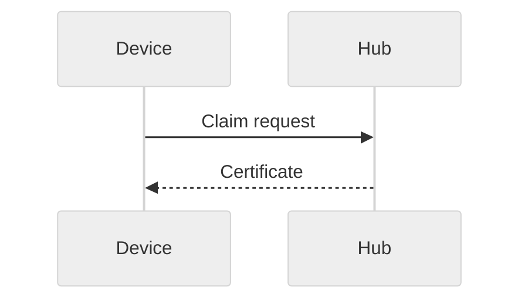

# Showcase {#showcase}

> [!NOTE]
> Alerts render like on GitHub. ==Highlighted==, ~~struck~~, H~2~O, x^2^, ++inserted++.

| Feature | Status | Notes |
| :------ | :----: | ----: |
| Tables  | ✅     | aligned<br>with breaks |
| Math    | ✅     | $E = mc^2$ |

- [x] Task done
- [ ] Task open
  - [ ] Nested task



$$
\int_0^\infty e^{-x^2}\,dx = \frac{\sqrt{\pi}}{2}
$$

```rust
fn main() {
    println!("Hello {}", 42); // comment
}
```

```cddl
claim = { id: tstr, ? ttl: uint .size 4 }
```

Term
: Definition list entry.

A footnote reference[^1] and a Hugo shortcode .

*[HTML]: Hyper Text Markup Language

HTML abbreviations work too.

<details>
<summary>Collapsed section</summary>

Hidden **content**.

</details>

[^1]: The footnote text.

## Links

- [Same-document anchor](#showcase)
- [Other document](other.md#second-section)
